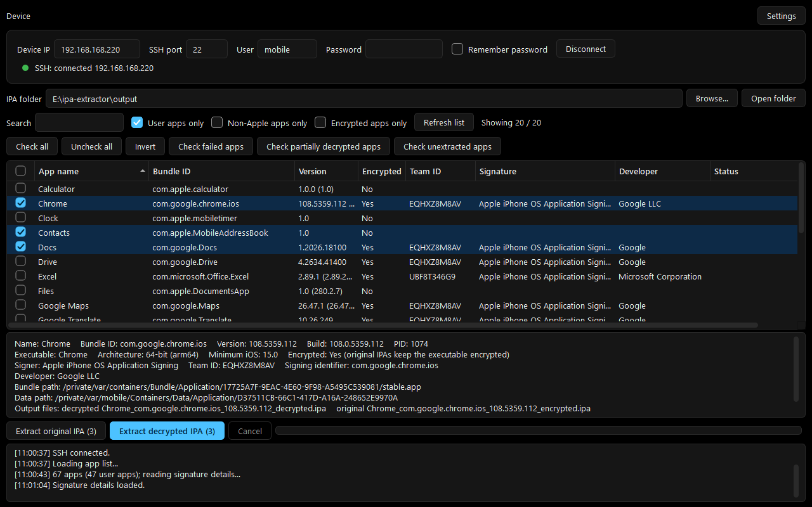
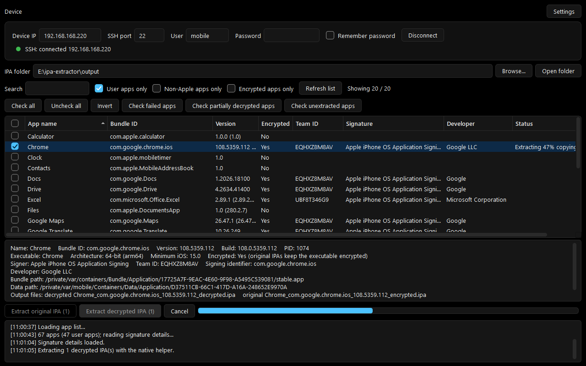
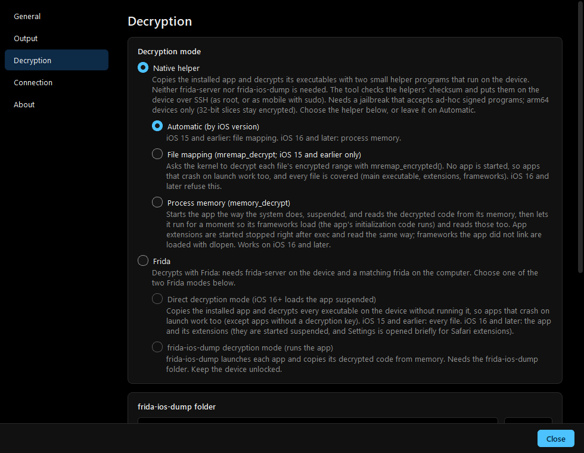

<p align="center"></p>

# IPA Extractor

A desktop GUI for pulling IPA files off a jailbroken iPhone or iPad over Wi-Fi or a USB cable (SSH), in two ways:

- **Original IPA** – packs the installed app as-is. Executables stay FairPlay-encrypted, so the IPA installs only on devices using the purchasing Apple ID (or with AppSync). Needs nothing but SSH, and works for apps that can no longer launch, such as 32-bit apps on iOS 11+.
- **Decrypted IPA** – an IPA with decrypted executables, made in one of two ways (*Settings → Decryption*): with two small helper programs run on the device, no Frida at all (*Native helper*, the default), or with Frida (*Frida*), which copies the installed app and decrypts its files on the device without running any of its code (*Direct decryption mode*) or launches the app and dumps it with [frida-ios-dump](https://github.com/AloneMonkey/frida-ios-dump) (*frida-ios-dump decryption mode*). Frida mode needs `frida-server` on the device.

## Screenshots

<p align="center"></p>

<p align="center"></p>

<p align="center"></p>

## Features

- Works with rootful and rootless jailbreaks.
- App list read over SSH with name, bundle ID, version, encryption state, 32/64-bit architecture, Team ID, signer and developer.
- Filters (user apps, non-Apple apps, encrypted apps), search, and checkboxes with bulk actions, including *Check failed apps*, *Check partially decrypted apps* and *Check unextracted apps*.
- Batch extraction with per-app status and an overall progress bar.
- Every decrypted IPA is checked on the computer, executable by executable, and files still encrypted are decrypted on the device (by file mapping on iOS 15 and earlier and, on iOS 16 and later, for apps whose files it can decrypt; from the memory of the suspended app for the others).
- Large batches stay stable: apps are closed after dumping, a stuck `frida-server` is restarted, and the batch pauses after repeated Frida failures.
- Configurable file names from `{name}`, `{bundle}`, `{version}`, `{build}` and `{type}`, with a preview and clash detection.
- Separate or shared output folders for decrypted and original IPAs.
- *Native helper* needs no Frida: two small arm64 programs (`helpers/`) are put on the device over SSH and decrypt every file of an app, extensions and frameworks included.
- Built-in setup: downloads frida-ios-dump and installs the `frida` version that matches the device.
- Several `frida` versions side by side: each device gets the one matching its frida-server.

## Requirements

**Device**

- A jailbroken iPhone or iPad, rootful (e.g. unc0ver, checkra1n, palera1n rootful) or rootless (e.g. Dopamine, palera1n rootless).
- An SSH server on the device, reachable over the network, or over a USB cable (Settings → Connection).
- To connect by USB: usbmuxd on the computer, which iTunes or the Apple Devices app brings on Windows, macOS has, and Linux gets from the `usbmuxd` package. The device must be unlocked (and trusted, if it asks).
- For decrypted IPAs in *Frida*: `frida-server` from the official Frida repository.
- For decrypted IPAs in *Native helper* (the default): nothing but SSH, a jailbreak that runs ad-hoc signed (ldid) programs as root, and an arm64 device. `sudo` is used when you log in as `mobile`.

**Computer**

- Only to run from source (the downloadable program needs none): Python 3.10 or later; the window needs PySide6 (Qt), the command line does not. The Python packages the tool needs ([Paramiko](https://www.paramiko.org/), [cryptography](https://cryptography.io/), and [PySide6](https://doc.qt.io/qtforpython-6/) for the window) are installed on first start, after asking.
- For decrypted IPAs made with frida-ios-dump: Node.js (`npm install` fetches `frida-objc-bridge` for frida-ios-dump) and a copy of frida-ios-dump; the tool can download it for you. *Direct decryption mode* and *Native helper* need neither.

## Setting up the device

1. **Jailbreak** the device with a jailbreak that supports its iOS version and chip. It installs a package manager (Sileo, Zebra or Cydia).
2. **Install OpenSSH.** In the package manager, search for and install `OpenSSH`. It listens on port 22. (palera1n also ships its own dropbear SSH server on port 44.)
3. **Choose the SSH account and password.**
   - **Rootful:** log in as `root`. Many rootful jailbreaks leave the well-known default password `alpine`; change it right away with `passwd` (and `passwd mobile` for the mobile account).
   - **Rootless:** log in as `mobile`, with the password set for the mobile user (on Dopamine: *Settings → Change mobile password*). The tool also gives it to `sudo` when it needs root.
4. **Install frida-server** (*Frida* only; the default *Native helper* does not need it). Add the source `https://build.frida.re` in the package manager and install `Frida`; the package manager picks the rootful or rootless build. It starts automatically.
5. **Find the device IP** in *Settings → Wi-Fi → (i)* next to the network.

Check the connection from a terminal with `ssh root@<device IP>` (rootful) or `ssh mobile@<device IP>` (rootless) before using the tool.

The `frida` on the computer must match the major version of frida-server on the device (e.g. 16.x with 16.x). Each installed version has its own folder; on connecting the tool picks the device's version or the newest with the same major, and offers to install one when none fits (*Settings → Decryption → Install Frida dependencies*).

## Getting started

You can download a program that runs without Python, or run the Python source.

### Download and run (no Python needed)

Download the file for your computer from the [Releases](https://github.com/albinteng/IPA-Extractor/releases) page, under *Assets*. If a release has none, use its source code (see [Run from source](#run-from-source)). The programs are not signed.

| Computer | File | What it contains |
| --- | --- | --- |
| Windows (x64) | `windows-x64.zip` | `IPA-Extractor.exe`, a single file |
| Linux (x64) | `linux-x64.tar.gz` | `IPA-Extractor`, a single file |
| macOS, Intel | `macos-intel.zip` | `IPA Extractor.app` |
| macOS, Apple Silicon | `macos-apple-silicon.zip` | `IPA Extractor.app` |

Started without arguments, the program opens the window. Started with arguments, it is the command line (see [CLI](#cli); every command works).

#### Windows

1. Unzip the archive into a folder of its own: the settings, the output and the downloaded Frida versions are kept beside `IPA-Extractor.exe`.
2. Double-click `IPA-Extractor.exe` for the window. For the command line open cmd or PowerShell in that folder (a double click shows no console, so the command line prints nothing there):

```
IPA-Extractor.exe devices
IPA-Extractor.exe decrypt --mode frida-direct --usb com.example.app
```

#### Linux

1. Unpack the archive into a folder of its own: the settings, the output and the downloaded Frida versions are kept beside the file.
2. Start it from a terminal, or double-click it in a file manager that runs executables:

```sh
tar -xzf IPA-Extractor-*-linux-x64.tar.gz
chmod +x IPA-Extractor            # only if the executable flag was lost
./IPA-Extractor                   # the window
./IPA-Extractor apps --ssh -H 192.168.1.20 -u root
```

The window needs a graphical desktop; for Chinese, Japanese or Korean text install a CJK font such as `fonts-noto-cjk`. To connect by USB, install the `usbmuxd` package.

#### macOS

1. Unzip, move `IPA Extractor.app` to *Applications* and open it. Because the app is not signed, macOS may refuse to open it the first time.
2. The command line is the program inside the app:

```sh
"/Applications/IPA Extractor.app/Contents/MacOS/IPA-Extractor" devices
alias ipa-extractor='"/Applications/IPA Extractor.app/Contents/MacOS/IPA-Extractor"'
ipa-extractor decrypt --usb com.example.app
```

The app itself is never modified: the settings are in `~/Library/Application Support/IPA Extractor` and the output in `~/Documents/IPA Extractor`.

#### Differences from running the source

- No Python or pip is involved. The *Frida* modes download the `frida` version a device needs when you ask for it (Frida 12 and 13 need Windows x64).
- frida-ios-dump needs Node.js, as from source.
- On Windows and Linux nothing is written until you change a setting or install something. A read-only folder uses `~/.ipa_extractor` instead.

### Run from source

You need Python 3.10 or later (see [Requirements](#requirements)).

#### Windows

1. Install Python from [python.org](https://www.python.org/downloads/) and tick *Add python.exe to PATH*.
2. Double-click `ipa_extractor.bat`. If PySide6 is missing, it offers to install it (`pip install PySide6-Essentials`); if `paramiko` is missing, the window offers to install it (with `pip install --user`, so no administrator rights are needed).

#### Linux

```sh
./ipa_extractor.sh
```

If Python's `venv` is missing, the script says so and, in a terminal, offers the command that installs it (Debian/Ubuntu `sudo apt-get install -y python3-venv`, and likewise for Fedora, Arch, openSUSE) and runs it only if you answer `y`. The script installs the window's toolkit (`PySide6-Essentials`) into `./.venv` by itself. The command line needs neither PySide6 nor a display: with any argument the script installs the Python packages it lacks (`paramiko`, `cryptography`) into `./.venv`. On a minimal Linux install Qt may need a few system libraries (on Debian/Ubuntu `sudo apt-get install -y libegl1 libxkbcommon0 libxcb-cursor0`).

On first start the window offers to install what is still missing of its Python packages into `./.venv`. For Chinese, Japanese or Korean UI text, install a CJK font such as `fonts-noto-cjk`.

#### macOS

```sh
brew install python   # or use the python.org installer
./ipa_extractor.sh
```

`ipa_extractor.sh` keeps the tool's Python packages in `./.venv`, created on first run, so the system Python is never modified.

## GUI

### Usage

1. Enter the device IP, SSH account (`root` or `mobile`, see above) and password, then click **Connect**. With *Connection* set to *USB cable* in Settings, choose the device in the USB device box instead of entering an IP. The app list loads over SSH.
2. Check the apps you want (click the check box, Shift-click for a range, double-click a row, or select rows and press Space or right-click; the box in the header checks every shown app).
3. Click **Extract original IPA** or **Extract decrypted IPA**.

Decrypted IPAs are made without Frida by default (*Native helper*): nothing needs installing. In **Settings → Decryption** leave the helper on *Automatic* (file mapping up to iOS 15; from iOS 16 file mapping for an app whose files it can all decrypt, process memory for any other app) or force one of them. A forced file mapping never switches to memory: on iOS 16 and later the files it cannot decrypt are listed as still encrypted.

To use Frida instead, open **Settings → Decryption**, choose *Frida* and click *Install Frida dependencies* (the device's frida-server version is recommended). For frida-ios-dump choose *frida-ios-dump decryption mode*: *Install frida-ios-dump* downloads it to a folder you choose and *Install Frida dependencies* also runs `npm install`; the device must stay unlocked with the screen on.

### Settings

| Page | Options |
| --- | --- |
| General | Language, font, text size, theme (*Follow system*, *Light*, *Dark*, or *Black* with a pure black background) |
| Output | File name templates (default `{name}_{bundle}_{version}_{type}`), separate output folders |
| Decryption | *Native helper* (the default; helper *Automatic*, *File mapping* or *Process memory*) or *Frida* (*Direct decryption mode* or *frida-ios-dump decryption mode*), with the options of the chosen mode; the others are greyed out |
| Connection | *SSH over the network* (the default) or *SSH over a USB cable* (the main window then shows a USB device box instead of the IP) |
| About | The version, the project page, the license, the system and libraries in use, where the settings are kept; **Copy information** puts it on the clipboard for a bug report |


`{type}` is `encrypted` or `original` for original IPAs (`original` when the executable was never encrypted). For decrypted IPAs it follows a check of every executable, done after each extraction: `decrypted`, `partial-decrypted-<architectures>` (some slices of the main executable are still encrypted; the log and the details pane list the files and why) or `partial-decrypted`. *Check partially decrypted apps* selects these apps.


Settings are stored in `settings.json` next to the tool (`~/.ipa_extractor.json` when its folder is read-only); only values that differ from the defaults are written. Delete the file to restore the defaults. *Remember password* stores the SSH password there in plain text.

## CLI

Everything the window does is also available without it, for scripts and servers: `ipa_cli.py` (or any arguments to `ipa_extractor.py` / `ipa_extractor.sh`; it needs the same Python packages but neither PySide6 nor a display). It reads the device and the options from `settings.json`, the file the window saves, and options given on the command line override it.

How to start it:

| | Downloaded program (no Python) | From source |
| --- | --- | --- |
| Windows | `IPA-Extractor.exe apps ...` (cmd or PowerShell, in its folder) | `python ipa_cli.py apps ...` |
| Linux | `./IPA-Extractor apps ...` | `python3 ipa_cli.py apps ...` or `./ipa_extractor.sh apps ...` |
| macOS | `"/Applications/IPA Extractor.app/Contents/MacOS/IPA-Extractor" apps ...` | `python3 ipa_cli.py apps ...` or `./ipa_extractor.sh apps ...` |

The examples below are written for the source (`python ipa_cli.py`); with the downloaded program, write its name instead, e.g. `IPA-Extractor.exe apps -H 192.168.1.20 -u root`.

```
python ipa_cli.py apps -H 192.168.1.20 -u root          list the apps (add --json for scripts)
python ipa_cli.py apps --usb -u mobile                  the same over the USB cable (devices lists the UDIDs for --udid)
python ipa_cli.py extract com.example.app               original IPAs
python ipa_cli.py decrypt --all --non-apple             decrypted IPAs, every app the filters let through
python ipa_cli.py decrypt --mode frida-direct com.example.app
python ipa_cli.py verify some.ipa                       is it really decrypted?
python ipa_cli.py config show                           the settings; config set theme black, config reset theme
```

| Command | What it does |
| --- | --- |
| `apps` | Lists the apps with name, bundle ID, version, encryption, team, signer, developer. Filters as in the window: `--user-only` / `--include-system`, `--non-apple` / `--include-apple`, `--encrypted-only` / `--include-decrypted`, `--search TEXT` (defaults from the settings; each pair overrides the window's choice either way) |
| `extract`, `decrypt` | Original or decrypted IPAs. Pick apps by bundle ID, `--all`, `--search`, `--unextracted` (no IPA in the output folders yet) or `--partial` (decrypted IPA still partly encrypted). `-o DIR`, `--name TEMPLATE`, `--overwrite`, `--skip-existing`, `--json` |
| `decrypt` options | `--mode native` / `frida-direct` / `frida-ios-dump`, `--helper auto` / `mremap` / `memory`, `--frida-port`, `--dump-dir`, `--install-frida`, `--repair` / `--no-repair`, `--close-after` / `--keep-open`, `--restart-frida` / `--no-restart-frida` (all default to the settings) |
| `verify` | Checks every executable of IPAs, like `ipa_verify.py`. Its exit status is its own: 0 all decrypted, 1 some IPA is not, 2 an IPA could not be read |
| `devices` | Lists the devices attached by USB, one per line: UDID, name, model, iOS version (`--json` for scripts; `cut -f1` gives the UDIDs). Every command that connects takes `--usb` (the cable instead of the network), `--udid UDID` (which device; implies `--usb`) and `--ssh` (the network, whatever the setting says); the `connection` and `usb_device` settings are the defaults |
| `install-frida`, `install-frida-ios-dump` | What the window's *Install Frida dependencies* and *Install frida-ios-dump* buttons do |
| `config` | `show`, `set KEY VALUE`, `reset KEY...`, `keys`, `path`: the same settings as the window, including the theme |

The SSH password comes from `--password`, the `IPA_PASSWORD` variable, the saved one (*Remember password*), or a prompt. Progress goes to stderr, results to stdout. Files that exist are replaced only with `--overwrite`. Ctrl+C stops the batch (finished files stay); a second Ctrl+C quits at once. Exit status: 0 everything done, 1 something failed, 2 wrong usage or no connection, 3 done but some IPAs are partly encrypted, 130 cancelled.

## Limitations

- **iOS 16 and later** refuse the old way of using `mremap_encrypted`. File mapping still works there for files whose encrypted range starts on a 16 KB boundary; for the others only code the system itself loads can be read (*Automatic* does that for such an app): the app's executable and its extensions (started suspended). Encrypted frameworks are decrypted by loading them into the app, which is let start without showing its UI. Watch apps, 32-bit slices and extensions that need a newer iOS stay encrypted. The app must have been installed with the device's own Apple ID; IPAs with files left encrypted are named `partial-decrypted`, and the log lists each file and why.
- **iOS 8 and other old devices (frida 12).** `frida-server` 12.x needs `frida` 12.x on the computer, which has no wheel for current Pythons: on Windows x64 the tool installs it with its own embeddable Python 3.8. Only *Direct decryption mode* works with it. Old SSH servers that only offer an `ssh-rsa` host key are accepted. Slices older than the one the device runs (armv6 or armv7 on a 64-bit device) are refused by the kernel and stay encrypted; the app still works.
- **Native helper.** The helpers are arm64 programs: devices that run only 32-bit code are not supported, and a 32-bit slice is left encrypted. They need a jailbreak that accepts ad-hoc signed programs with entitlements. *File mapping* (`mremap_decrypt`) covers every file and starts nothing; iOS 16 and later accept it only for files whose encrypted range starts on a 16 KB boundary; with *Automatic* an app that has any other file is read from memory instead, and when you choose *File mapping* yourself the files it cannot do stay encrypted and are listed. *Process memory* (`memory_decrypt`) starts the app suspended, reads the main executable before any of its code runs, lets the app run for a moment so its frameworks load, and loads the others with `dlopen` (not for arm64e apps). See `helpers/README.md`.
- Apps that crash on launch can only be decrypted with *Native helper* (file mapping) or *Direct decryption mode*; with frida-ios-dump, extract the original IPA instead.
- On iOS 16 and later, frida-server 17 sometimes crashes while it holds an extension suspended. With *Restart frida-server and retry on errors* the tool restarts it and tries the affected files again (up to three more times, while that gets further); either way it lets go of whatever the crashed frida-server held suspended. Killing or stopping frida-server by hand many times in a row has left a device unable to start services until it was restarted.

## Adding a language

Each language is a JSON file in `locales/` named by its language tag, e.g. `ja.json`. Copy `en.json`, translate the values, and set `_name` (shown in the language list) and `_fonts` (preferred UI fonts, first installed one wins). Values are Python `str.format` templates: keep `{placeholders}` unchanged and double literal braces. Missing keys fall back to English; the tests check every file against `en.json`.

## Project layout

| File | Purpose |
| --- | --- |
| `ipa_extractor.py` | Entry point: starts the window, or the command line when it gets arguments |
| `gui/` | The window (PySide6): main window, Settings (with About), the Frida install window, themes, the app list |
| `device_models.json` | Marketing names of iPhone, iPad and iPod models by identifier (iPhone12,1 is iPhone 11); radio and region variants share a name. A model that is not listed shows its identifier, so add a line for a new device |
| `usbmux.py` | A small usbmuxd client: lists the devices on USB and carries SSH through the cable (like `iproxy`, without needing it) |
| `engine.py` | What needs no window: settings, SSH, and the engine (`DumpEngine`) that copies and decrypts apps; shared by the GUI and the CLI, never imports Qt |
| `ipa_cli.py` | Command line: the same features without the window |
| `ipa_extractor.bat`, `ipa_extractor.sh` | Launchers for Windows and Linux/macOS |
| `app_paths.py`, `workers.py` | For the program built without Python: where it keeps its files, and the mode in which it runs its own helper processes |
| `build.py` | Builds that program with [Nuitka](https://nuitka.net/) |
| `device_apps.py` | Lists installed apps over SSH/SFTP with the names the Home screen shows |
| `ipa_extract.py` | Streams an installed bundle over SSH into an IPA without decrypting it |
| `app_info.py` | Reads Info.plist, encryption state and code signature; builds IPA file names |
| `dump_worker.py` | Runs frida-ios-dump's `dump.py` unchanged, reporting progress to the GUI |
| `ipa_verify.py` | Checks every Mach-O slice of an IPA for encryption (also a command-line tool) |
| `ipa_repair.py` | Plans which files to decrypt on the device and patches the results into the IPA |
| `repair_worker.py`, `repair_agent.js` | Decrypt files on the device with Frida (`mremap_encrypted` or reading memory) |
| `native_decrypt.py` | The same without Frida: uploads and runs the helpers in `helpers/` over SSH |
| `helpers/` | The two device-side helper programs: `src/` (C source), `bin/` (the built, signed binaries), `README.md` |
| `.github/workflows/build-helpers.yml` | Builds the helpers from `helpers/src` on a macOS runner |
| `.github/workflows/tests.yml`, `release.yml` | Run the tests on the three systems; build the downloads when a version tag is pushed |
| `frida_versions.py` | Keeps several `frida` versions side by side and picks one per device |
| `frida_probe.py` | Checks the connection to frida-server with a given `frida` version |
| `remote.py` | Runs shell commands on the device |
| `i18n.py`, `locales/` | UI languages |
| `assets/` | App icon |
| `tests/` | Unit tests: `python -m unittest discover -s tests` |

## Third-party software

The downloadable programs contain the first group below (compiled into them with Nuitka; the Qt libraries are separate
files inside the program). From source, these are installed with pip instead. The second group is not part of IPA
Extractor: each is downloaded when it is used. The licenses are those the packages declare (checked against the versions
the release is built with). The *About* page of Settings lists them, and its *Licenses* button shows the full license
texts, so a download is a single file; `licenses.txt` holds those texts.

| Software | Used for | License | In the downloadable program |
| --- | --- | --- | --- |
| [PySide6 / Qt 6](https://doc.qt.io/qtforpython-6/) | The window | LGPL-3.0 (PySide6 is "LGPL-3.0-only OR GPL-2.0-only OR GPL-3.0-only"; this project uses it under the LGPL) | yes, as separate library files |
| [Paramiko](https://www.paramiko.org/) | SSH and SFTP | LGPL-2.1 | yes |
| [scp](https://github.com/jbardin/scp.py) | File transfer used by frida-ios-dump | LGPL-2.1-or-later | yes |
| [cryptography](https://cryptography.io/) | Reading code signature certificates | Apache-2.0 or BSD-3-Clause (its wheel carries OpenSSL, Apache-2.0) | yes |
| [bcrypt](https://github.com/pyca/bcrypt), [PyNaCl](https://github.com/pyca/pynacl) (with libsodium, ISC), [cffi](https://cffi.readthedocs.io/) (MIT-0, with libffi, MIT), pycparser (BSD-3-Clause) | Paramiko's own dependencies | Apache-2.0 / ISC / MIT-0 / MIT / BSD-3-Clause | yes |
| Python | The program itself | PSF License | yes |
| Microsoft Visual C++ runtime | Needed by Python and Qt on Windows | Microsoft's redistributable terms | yes (Windows only) |
| [Frida](https://frida.re/) (`frida` Python package, `frida-server`) | Launching and decrypting apps | wxWindows Library Licence 3.1 | no, downloaded when you install it in Settings |
| [frida-ios-dump](https://github.com/AloneMonkey/frida-ios-dump) | Dumping decrypted IPAs | MIT | no, downloaded when you install it in Settings |
| [frida-objc-bridge](https://github.com/frida/frida-objc-bridge) | Objective-C runtime access used by frida-ios-dump | LGPL-2.0 with wxWindows exception 3.1 | no, comes with frida-ios-dump |

Qt, Paramiko and scp are under the LGPL. This project's source is public and `build.py` rebuilds the program, so it can
be built again with another version of these libraries; the Qt libraries are separate files (in the single-file builds
they are unpacked when the program starts) and can be exchanged for another build of the same Qt version. Whether that
satisfies the LGPL for a single-file program is a legal question this project has not had answered; if it matters to you,
use the source or ask a lawyer. Qt itself contains code under other open-source licenses (see https://doc.qt.io/qt-6/licenses-used-in-qt.html).

The helpers in `helpers/` are this project's own code (MIT). How `memory_decrypt` starts an app, reads its memory and calls `dlopen` in it was worked out with the help of the device-side code of [ipadecrypt](https://github.com/londek/ipadecrypt) (MIT), which solves the same problem; none of its code is copied.

## Disclaimer

Use this tool only with apps you are entitled to, for purposes such as backup, interoperability and security research, and in accordance with the laws and terms that apply to you. Decrypted IPAs must not be redistributed.

## License

[MIT](LICENSE)
